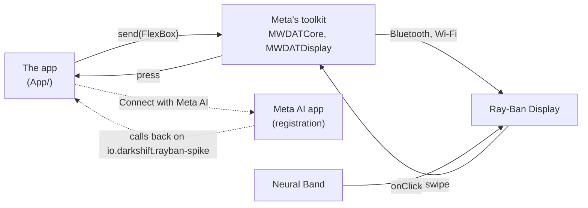

# spike-rayban

What an iPhone app can do with [Meta Ray-Ban Display](https://www.meta.com/ai-glasses/meta-ray-ban-display/) glasses,
through Meta's [Wearables Device Access Toolkit](https://github.com/facebook/meta-wearables-dat-ios) 1.0.1: draw on
the glasses' display, and take presses from the Neural Band. A small app, with nothing of Infrared in it, that runs on a
simulator with Meta's simulated glasses or on an iPhone with a real pair. Since 2026-11-08 it also seeks a UWB beacon,
"Kelsey Finder": the distance and the way to it on the phone and in the lens ([Seek a UWB beacon](#seek-a-uwb-beacon)).

Infrared's own use of the glasses, its planning session at a glance in the lens, is darkshiftio/localred's iPhone app
(`app/Mobile/Glasses`, and `docs/app.md`, "Glasses"). This spike's handling of the toolkit is adapted from it.

| What | Where it stands, 2026-11-09 |
|---|---|
| A simulator with Meta's simulated Ray-Ban Display (`make sim`) | Registered with the simulated Meta AI, the session and its display opened, every screen drawn by the toolkit and pressed through from the phone |
| A real pair | The seek's lens drawn on jarededwards's pair on 2026-11-08 |
| A press from the glasses | Proven only on a real pair: the simulated glasses' own inputs do not press the display's buttons ([findings](docs/findings.md#the-simulated-glasses)) |
| Seeking a UWB beacon | Distance from a DWM3001CDK on Qorvo's firmware, on jarededwards's iPhone 17 Pro and in the lens, on 2026-11-08; a test away from the Mac, the beacon on a power bank, was next. The direction arrow, which needs camera assistance, is not reported working yet |

## What it does

The app draws a glance on the glasses: where the demo is, what goes on, one line on a card with a note under it, and
up to three buttons, the primary taking the focus. A pinch of the Neural Band presses the button in focus and a swipe
moves to the next; the press comes back to the phone, which draws the next glance. The demo is five screens in the shape
of Infrared's planning session: Hello, a question (Your turn: Talk or Skip), the answer heard (Listening: Send or
Cancel), the answer read back (Keep it?: Keep it or Change), and Kept, which counts the presses that came from the
glasses. The answers are made up: nothing listens.

| Your turn | Listening | Keep it? | Kept |
|---|---|---|---|
|  |  |  |  |

Drawn by the toolkit on its simulated Ray-Ban Display, on an iPhone 18 Pro simulator, on 2026-11-01.



On the phone, the app shows Meta AI's word on its registration, the glasses Meta AI knows with their link and battery,
whether the display is drawing and how long the last draw took, what the glasses show now with the same buttons (a tap
there presses as the glasses do), and every press with where it came from: glasses, phone or autoplay.

## Run it on a simulator

Xcode 27.1 or later and XcodeGen 2.46 (`brew install xcodegen`); no Apple account, no glasses.

```bash
make sim
```

It builds the app, opens it on the simulator "iPhone 18 Pro" (`SIMULATOR="iPhone 17" make sim` for another) with the
preview on and autoplay pressing the button in focus every five seconds, and saves a screenshot after each press to
`.build/screens/`. The check arguments are the app's: `-spike.preview YES` and `-spike.autoplay YES`, neither kept.

## On your iPhone, with your glasses

1. In the Meta AI app (v254 or later): pair the glasses and the Neural Band, let the glasses update (firmware v21 or
   later for Ray-Ban Display), and turn on Developer Mode: Settings, App Info, tap the app's version five times, then
   the Developer Mode switch and Enable (Meta's
   [getting started](https://wearables.developer.meta.com/docs/develop/dat/getting-started-toolkit/)). It turns
   itself off after a firmware update.
2. Copy `Config/Signing.example.xcconfig` to `Config/Signing.local.xcconfig` and put your Apple Developer team in it.
3. Plug in and unlock the iPhone, then `make device DEVICE=<identifier>` (the identifier from
   `xcrun devicectl list devices`). The first signed build registers `io.darkshift.rayban-spike` with your team.
4. In the app: Connect with Meta AI, and Allow in Meta AI. Put the glasses on, unfolded: Hello shows in the right lens.
5. Pinch Start, and press through with the Neural Band. Each press shows in the app's Presses as "glasses".

Once registered, the app is listed in Meta AI under Settings, App connections, Developer mode apps.

## Seek a UWB beacon

The app finds a UWB beacon over Bluetooth, then measures the way to it with Apple's Nearby Interaction, and says and
shows it: on the phone, in the glasses' lens, and in their speakers. The beacon is a Qorvo DWM3001CDK board on Qorvo's
Nearby Interaction firmware (QANI); darkshiftio/beacon-firmware has the board, its firmware and the tools to flash it,
and infrared-docs-internal's `docs/beacons/` the pages for people. The beacon is "Kelsey"; every screen of it is titled
"Kelsey Finder" (`Seeker.name`).

**You need** an iPhone with Apple's UWB chip (the seek screen's This iPhone says Precise distance: Yes), a beacon on
QANI within Bluetooth range, and the glasses for the lens. Close Qorvo's own iPhone app first: QANI takes one connection at a time.

**Start it** from the first row of the phone's screen, Kelsey Finder, or by pinching Find on the lens ("Find Kelsey").
It then:

1. scans for the beacon over Bluetooth, by Qorvo's service (QNIS) or its name, and connects;
2. asks it for its accessory configuration (`0x0A`), hands that to Nearby Interaction, and sends back the phone's
   (`0x0B`); the beacon answers that UWB started (`0x02`) (beacon-firmware `docs/qani.md` has the protocol);
3. shows each reading: the distance in big figures, an arrow when there is a direction, and one line on the lens.

| What | How |
|---|---|
| Distance | Every reading: centimetres in fives under a metre, tenths of a metre above. Spoken in whole metres from 5 m, tenths from 1 to 5 m, tens of centimetres under 1 m. "You're there" within 0.4 m |
| Direction | Only with camera assistance on (Direction, with the camera): hold the phone up, camera forward, and sweep it slowly. An arrow on the phone and in the lens. iPhones give a third-party beacon no direction without the camera |
| Who moves | The phone's motion (Core Motion) says whether you are walking: the distance growing while you stand still is "Kelsey is moving away"; shrinking, "Kelsey is coming closer"; growing while you walk with no arrow, "Wrong way: turn around" |
| Hot and cold | A short beep through the glasses' speakers, faster as you get closer: high while closing in, low while drifting apart, middle while steady |
| Too far | Past 10 m (a stepper, 2 to 50): the lens's line starts "Past 10 m", the voice says "Kelsey is past 10 meters", and the phone buzzes, once until he comes back inside |
| Lost | If the signal drops, "Lost Kelsey. Last seen 8.2 m, slightly left, at 18:42" on the lens, and said once |
| The log | Every reading, to a CSV file in the app's Documents, `seek-<date>-<time>.csv`: the raw distance, angle and direction vector, the arrow, the trend, whether you moved |

Pull the logs off the phone:

```bash
xcrun devicectl device copy from --device <identifier> --domain-type appDataContainer \
  --domain-identifier io.darkshift.rayban-spike --source Documents --destination <folder>
```

**Check arguments:** `-seek.start YES` starts seeking at launch, and `-seek.simulate YES` seeks a made-up beacon that
walks closer, with no voice and no beeps (`SEEK=1 scripts/run-simulator` on a simulator, with the preview on).

## The gate

`make verify`: the harness, shellcheck on `scripts/`, the Xcode project from `project.yml`, and the app built for the
iOS Simulator and for a generic iPhone, unsigned. There is no CI.

**Builds.** The toolkit is a Swift package of binary frameworks, fetched from GitHub. A workstation whose git rewrites
`https://github.com/` to SSH clones it with the person's SSH key; when that key is locked, `GIT_CONFIG_GLOBAL=/dev/null
make verify` fetches the public package over HTTPS.

## Layout

| Path | What it holds |
|---|---|
| `App/SpikeApp.swift` | The app: starts the toolkit, sends the newest glance, handles Meta AI's callback, the check arguments |
| `App/Glasses.swift` | The toolkit: registration, the glasses, the device session and its display, one send at a time, the preview |
| `App/GlassesCard.swift` | A glance in the toolkit's views (`FlexBox`, `Text`, `ButtonGroup`, `Button`) |
| `App/Glance.swift` | A glance, and the demo's five screens |
| `App/SpikeView.swift` | The phone's screen |
| `App/BeaconLink.swift` | The beacon over Bluetooth: scan, connect, Qorvo's service, its messages |
| `App/Seeker.swift` | Seeking: Nearby Interaction's session, the readings, the words for the lens and the voice, the alerts |
| `App/SeekView.swift` | Seeking on the phone: the arrow, the distance, the switches, what Bluetooth and Nearby Interaction say |
| `App/SeekLog.swift`, `App/Beeper.swift` | The readings' CSV log, and the hot and cold beeps |
| `Config/Info.plist` | The toolkit's keys: the URL scheme, `MWDAT` (Developer Mode, analytics and crash reports opted out), its Bluetooth, accessory and Wi-Fi links; why the app asks for Nearby Interaction, motion and the camera |
| `Config/Signing*.xcconfig` | Automatic signing with each person's own team, kept in the git-ignored `Signing.local.xcconfig` |
| `scripts/` | `verify`, `run-simulator`, `install-device` |
| `docs/findings.md` | What the spike learned about the toolkit and the glasses |
