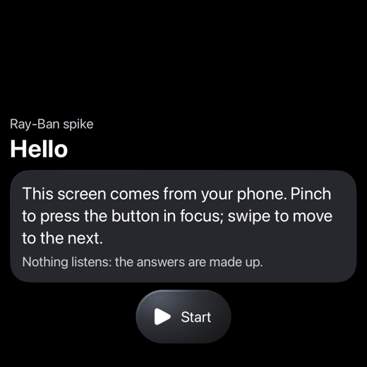
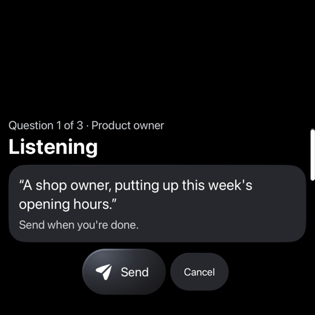
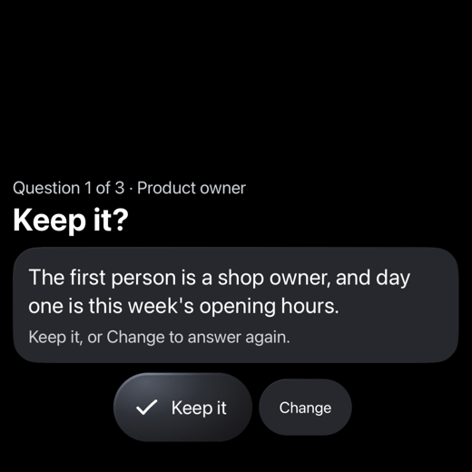
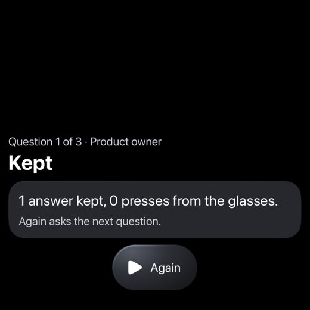
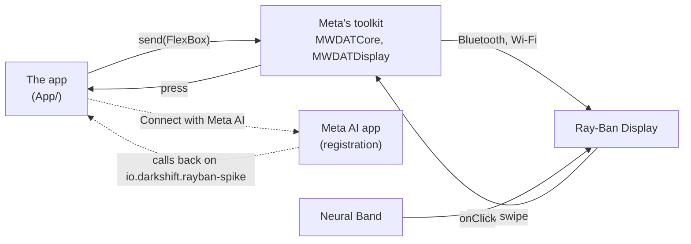

# spike-rayban

What an iPhone app can do with [Meta Ray-Ban Display](https://www.meta.com/ai-glasses/meta-ray-ban-display/) glasses,
through Meta's [Wearables Device Access Toolkit](https://github.com/facebook/meta-wearables-dat-ios) 1.0.1: draw on
the glasses' display, and take presses from the Neural Band. A small app, with nothing of Infrared in it, that runs on a
simulator with Meta's simulated glasses or on an iPhone with a real pair.

Infrared's own use of the glasses, its planning session at a glance in the lens, is darkshiftio/localred's iPhone app
on the branch `feat/app-glasses` (`app/Mobile/Glasses`, and `docs/app.md`, "Glasses"). This spike's handling of the
toolkit is adapted from it.

| What | Where it stands, 2026-11-01 |
|---|---|
| A simulator with Meta's simulated Ray-Ban Display (`make sim`) | Registered with the simulated Meta AI, the session and its display opened, every screen drawn by the toolkit and pressed through from the phone |
| A real pair | Not yet run |
| A press from the glasses | Proven only on a real pair: the simulated glasses' own inputs do not press the display's buttons ([findings](docs/findings.md#the-simulated-glasses)) |

## What it does

The app draws a glance on the glasses: where the demo is, what goes on, one line on a card with a note under it, and
up to three buttons, the primary taking the focus. A pinch of the Neural Band presses the button in focus and a swipe
moves to the next; the press comes back to the phone, which draws the next glance. The demo is five screens in the shape
of Infrared's planning session: Hello, a question (Your turn: Talk or Skip), the answer heard (Listening: Send or
Cancel), the answer read back (Keep it?: Keep it or Change), and Kept, which counts the presses that came from the
glasses. The answers are made up: nothing listens.

| Your turn | Listening | Keep it? | Kept |
|---|---|---|---|
|  |  |  |  |

Drawn by the toolkit on its simulated Ray-Ban Display, on an iPhone 18 Pro simulator, on 2026-11-01.



On the phone, the app shows Meta AI's word on its registration, the glasses Meta AI knows with their link and battery,
whether the display is drawing and how long the last draw took, what the glasses show now with the same buttons (a tap
there presses as the glasses do), and every press with where it came from: glasses, phone or autoplay.

## Run it on a simulator

Xcode 27.1 or later and XcodeGen 2.46 (`brew install xcodegen`); no Apple account, no glasses.

```bash
make sim
```

It builds the app, opens it on the simulator "iPhone 18 Pro" (`SIMULATOR="iPhone 17" make sim` for another) with the
preview on and autoplay pressing the button in focus every five seconds, and saves a screenshot after each press to
`.build/screens/`. The check arguments are the app's: `-spike.preview YES` and `-spike.autoplay YES`, neither kept.

## On your iPhone, with your glasses

1. In the Meta AI app (v254 or later): pair the glasses and the Neural Band, let the glasses update (firmware v21 or
   later for Ray-Ban Display), and turn on Developer Mode: Settings, App Info, tap the app's version five times, then
   the Developer Mode switch and Enable (Meta's
   [getting started](https://wearables.developer.meta.com/docs/develop/dat/getting-started-toolkit/)). It turns
   itself off after a firmware update.
2. Copy `Config/Signing.example.xcconfig` to `Config/Signing.local.xcconfig` and put your Apple Developer team in it.
3. Plug in and unlock the iPhone, then `make device DEVICE=<identifier>` (the identifier from
   `xcrun devicectl list devices`). The first signed build registers `io.darkshift.rayban-spike` with your team.
4. In the app: Connect with Meta AI, and Allow in Meta AI. Put the glasses on, unfolded: Hello shows in the right lens.
5. Pinch Start, and press through with the Neural Band. Each press shows in the app's Presses as "glasses".

Once registered, the app is listed in Meta AI under Settings, App connections, Developer mode apps.

## The gate

`make verify`: the harness, shellcheck on `scripts/`, the Xcode project from `project.yml`, and the app built for the
iOS Simulator and for a generic iPhone, unsigned. There is no CI.

**Builds.** The toolkit is a Swift package of binary frameworks, fetched from GitHub. A workstation whose git rewrites
`https://github.com/` to SSH clones it with the person's SSH key; when that key is locked, `GIT_CONFIG_GLOBAL=/dev/null
make verify` fetches the public package over HTTPS.

## Layout

| Path | What it holds |
|---|---|
| `App/SpikeApp.swift` | The app: starts the toolkit, sends the newest glance, handles Meta AI's callback, the check arguments |
| `App/Glasses.swift` | The toolkit: registration, the glasses, the device session and its display, one send at a time, the preview |
| `App/GlassesCard.swift` | A glance in the toolkit's views (`FlexBox`, `Text`, `ButtonGroup`, `Button`) |
| `App/Glance.swift` | A glance, and the demo's five screens |
| `App/SpikeView.swift` | The phone's screen |
| `Config/Info.plist` | The toolkit's keys: the URL scheme, `MWDAT` (Developer Mode, analytics and crash reports opted out), its Bluetooth, accessory and Wi-Fi links |
| `Config/Signing*.xcconfig` | Automatic signing with each person's own team, kept in the git-ignored `Signing.local.xcconfig` |
| `scripts/` | `verify`, `run-simulator`, `install-device` |
| `docs/findings.md` | What the spike learned about the toolkit and the glasses |
